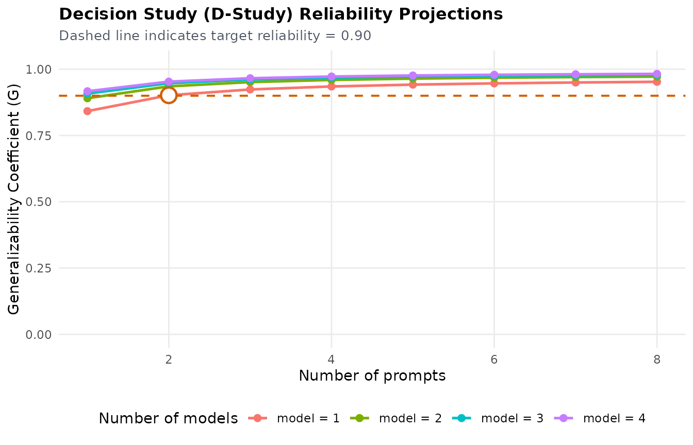
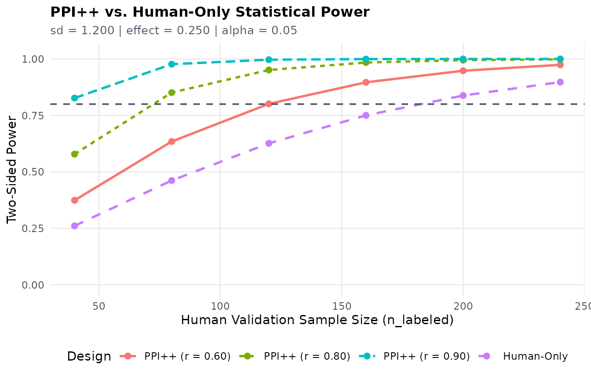
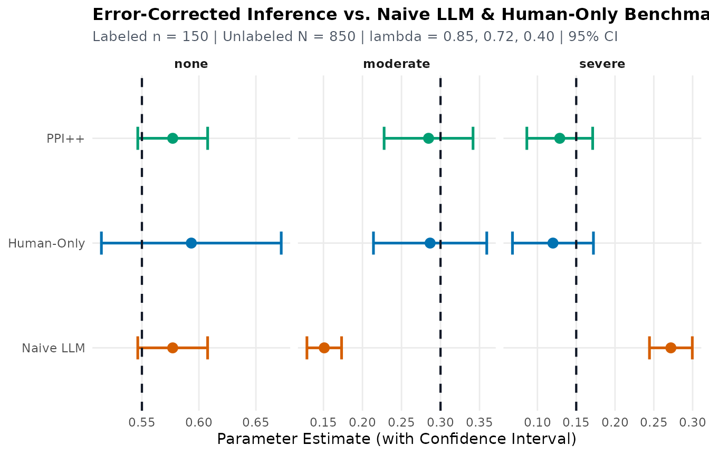

# Designing Validation Studies: G/D-Studies, Sample Sizing, Prevalence PPI, and APA Reporting

## Planning an LLM-Assisted Research Study From Start to Finish

A rigorous LLM measurement study requires answering four quantitative
design questions *before* spending API budget or human annotator hours:

1.  **Instrument reliability
    ([`g_study()`](https://marcusharrisphd.com/llmmetric/reference/g_study.md)
    &
    [`d_study()`](https://marcusharrisphd.com/llmmetric/reference/d_study.md)):**
    How many prompt paraphrases and models should we average per text to
    hit reliability $`G \ge 0.90`$ at minimum cost?
2.  **Human validation sample size
    ([`ppi_sample_size()`](https://marcusharrisphd.com/llmmetric/reference/ppi_sample_size.md)
    &
    [`ppi_power()`](https://marcusharrisphd.com/llmmetric/reference/ppi_power.md)):**
    Given a corpus of $`M = 2{,}000`$ texts and pilot LLM-human
    correlation $`r`$, how many texts must humans double-code to reach
    target precision or 80% statistical power?
3.  **Categorical prevalence estimation
    ([`ppi_proportion()`](https://marcusharrisphd.com/llmmetric/reference/ppi_proportion.md)):**
    When coding discrete survey themes or clinical categories, how do we
    obtain valid marginal and simultaneous confidence intervals for
    class prevalences?
4.  **Resumable execution & reporting
    ([`code_texts()`](https://marcusharrisphd.com/llmmetric/reference/code_texts.md) +
    [`format_apa_table()`](https://marcusharrisphd.com/llmmetric/reference/format_apa_table.md)):**
    How do we protect large batch runs against mid-run API failures and
    export clean APA 7th-edition tables?

``` r

library(llmmetric)
```

------------------------------------------------------------------------

## 1. Cost-Aware D-Study Optimization

Using the built-in `ema_coded` pilot dataset (120 diary entries crossed
with 3 prompts $`\times`$ 2 models), we estimate variance components via
REML and optimize the facet design under unequal costs (suppose running
an extra model costs $`3\times`$ as much as running an extra prompt
paraphrase):

``` r

data(ema_coded)

g <- g_study(ema_coded, score_col = "llm_score", facets = c("prompt", "model"))
format_apa_table(g)
#> **Generalizability Study Variance Component Decomposition**
#> 
#> | Component | Variance | SD | % Total | Role |
#> | --- | --- | --- | --- | --- |
#> | unit_id | 1.741 | 1.320 | 82.1 | Universe Score |
#> | prompt | 0.022 | 0.148 | 1.0 | Absolute Error Only |
#> | model | 0.005 | 0.071 | 0.2 | Absolute Error Only |
#> | unit_id:prompt | 0.101 | 0.318 | 4.8 | Relative & Absolute Error |
#> | unit_id:model | 0.053 | 0.229 | 2.5 | Relative & Absolute Error |
#> | prompt:model | 0.025 | 0.158 | 1.2 | Absolute Error Only |
#> | Residual | 0.173 | 0.416 | 8.2 | Relative & Absolute Error |
#> 
#> *Note.* Units = 120; G (Erho^2) = 0.951; Phi = 0.944; estimation method = REML.

d_cost <- d_study(
  g,
  grid = list(prompt = 1:8, model = 1:4),
  target = 0.90,
  metric = "g",
  costs = c(prompt = 1, model = 3)
)
d_cost
#> 
#> ── Decision Study (D-Study) Projections
#> Evaluated 32 designs | Target: G (Erho^2) >= 0.90
#> Lowest-cost recommended design: prompt=2, model=1 (2 calls/unit -> G = 0.902,
#> Phi = 0.889)
#> # A tibble: 2 × 10
#>   prompt model n_replicates total_calls  cost g_coef phi_coef sem_relative
#>    <int> <int>        <int>       <dbl> <dbl>  <dbl>    <dbl>        <dbl>
#> 1      2     1            1           2     5  0.902    0.889        0.436
#> 2      1     3            1           3    10  0.908    0.893        0.420
#> # ℹ 2 more variables: sem_absolute <dbl>, meets_target <lgl>
```

``` r

autoplot(d_cost)
```



The D-study identifies the Pareto-minimal, lowest-cost combination
hitting $`G \ge 0.90`$ and reveals via `d_cost$asymptotes` whether
adding more prompts alone eventually plateaus due to `unit:model`
interaction variance.

------------------------------------------------------------------------

## 2. Sizing the Human Validation Subset (`ppi_sample_size()` & `ppi_power()`)

Once the pilot validation subset is coded,
[`ppi_sample_size()`](https://marcusharrisphd.com/llmmetric/reference/ppi_sample_size.md)
computes the exact number of human annotations needed for either a
target standard error (`target_se`) or target two-sided statistical
power (`effect` + `power`), accounting for the finite corpus floor
$`\sigma / \sqrt{n_{\text{total}}}`$:

``` r

agg <- aggregate_scores(ema_coded, score_col = "llm_score")
pilot_fit <- ppi_lm(human_score ~ x + group, data = agg, pred_col = "llm_score")

# Plan a full study of 2,000 EMA entries targeting SE <= 0.06 on predictor x
plan_se <- ppi_sample_size(
  target_se = 0.06,
  n_total = 2000,
  pilot = pilot_fit,
  term = "x"
)
plan_se
#> 
#> ── PPI++ Human Validation Sample-Size Plan
#> Inputs (pilot_ppi++): sd = 1.163 | r = 1.000 | Target SE = 0.0600
#> Required human validation n = 20 (vs. 376 human-only -> saves 356 annotations,
#> 94.7%)
#> Projected PPI++ SE = 0.0261 | Effective n = 1980.4

# Plan for 80% power to detect effect = 0.25 with sd = 1.2 and LLM correlation r = 0.82
plan_pow <- ppi_sample_size(
  effect = 0.25,
  power = 0.80,
  sd = 1.2,
  r = 0.82,
  n_total = 2000
)
plan_pow
#> 
#> ── PPI++ Human Validation Sample-Size Plan
#> Inputs (supplied): sd = 1.200 | r = 0.820 | Target SE = 0.0892
#> Required human validation n = 64 (vs. 181 human-only -> saves 117 annotations,
#> 64.6%)
#> Projected PPI++ SE = 0.0886 | Effective n = 183.3 | Power = 0.805
```

We can also visualize how statistical power scales across human
validation sizes $`n_{\text{labeled}}`$ and LLM-human correlations $`r`$
relative to human-only estimation:

``` r

pw <- ppi_power(
  n_labeled = seq(40, 240, by = 40),
  n_total = 2000,
  effect = 0.25,
  sd = 1.2,
  r = c(0.60, 0.80, 0.90)
)
pw
#> 
#> ── PPI++ Precision & Power Projections
#> Source: supplied | sd = 1.200 | effect = 0.250 | alpha = 0.05
#> # A tibble: 18 × 10
#>    n_labeled n_unlabeled n_total     r se_human se_ppi var_reduction effective_n
#>        <int>       <int>   <int> <dbl>    <dbl>  <dbl>         <dbl>       <dbl>
#>  1        40        1960    2000   0.6   0.190  0.153           1.55        61.8
#>  2        80        1920    2000   0.6   0.134  0.109           1.53       122. 
#>  3       120        1880    2000   0.6   0.110  0.0891          1.51       181. 
#>  4       160        1840    2000   0.6   0.0949 0.0776          1.50       239. 
#>  5       200        1800    2000   0.6   0.0849 0.0698          1.48       296. 
#>  6       240        1760    2000   0.6   0.0775 0.0640          1.46       351. 
#>  7        40        1960    2000   0.8   0.190  0.116           2.68       107. 
#>  8        80        1920    2000   0.8   0.134  0.0833          2.59       207. 
#>  9       120        1880    2000   0.8   0.110  0.0691          2.51       301. 
#> 10       160        1840    2000   0.8   0.0949 0.0608          2.43       389. 
#> 11       200        1800    2000   0.8   0.0849 0.0553          2.36       472. 
#> 12       240        1760    2000   0.8   0.0775 0.0512          2.29       549. 
#> # ℹ 6 more rows
#> # ℹ 2 more variables: power_human <dbl>, power_ppi <dbl>
autoplot(pw, metric = "power")
```



------------------------------------------------------------------------

## 3. Categorical Prevalence Estimation (`ppi_proportion()`)

Many text-coding workflows estimate population **category prevalences**
(e.g., percentage of clinical notes showing `"none"`, `"moderate"`, or
`"severe"` symptoms). Even modest classifier confusion dramatically
biases Naive LLM proportions.
[`ppi_proportion()`](https://marcusharrisphd.com/llmmetric/reference/ppi_proportion.md)
estimates class prevalences with optimal per-category power-tuning
$`\hat{\lambda}_c^*`$ and optional Bonferroni-adjusted simultaneous
confidence intervals (`simultaneous = TRUE`):

``` r

set.seed(2030)
lvls <- c("none", "moderate", "severe")
true_probs <- c(none = 0.55, moderate = 0.30, severe = 0.15)
n_tot <- 1000L

y_true <- factor(sample(lvls, n_tot, replace = TRUE, prob = true_probs), levels = lvls)
# LLM systematically over-classifies "moderate" cases as "severe"
y_llm <- y_true
flip <- (y_true == "moderate") & (runif(n_tot) < 0.45)
y_llm[flip] <- "severe"

prop_df <- tibble::tibble(
  human_cat = factor(c(as.character(y_true[1:150]), rep(NA_character_, n_tot - 150L)), levels = lvls),
  llm_cat = y_llm
)

fit_prop <- ppi_proportion(prop_df, truth_col = "human_cat", pred_col = "llm_cat")
fit_prop_sim <- ppi_proportion(prop_df, truth_col = "human_cat", pred_col = "llm_cat", simultaneous = TRUE)

format_apa_table(fit_prop)
#> **Comparison of Naive LLM, Human-Only, and PPI++ Parameter Estimates**
#> 
#> | Term | Estimator | Estimate | SE | 95% CI | p | Eff. Gain |
#> | --- | --- | --- | --- | --- | --- | --- |
#> | none | Naive LLM | 0.577 | 0.016 | [0.546, 0.608] | &lt; .001 | -- |
#> | none | Human-Only | 0.593 | 0.040 | [0.514, 0.672] | &lt; .001 | 1.00x |
#> | none | PPI++ | 0.577 | 0.016 | [0.546, 0.608] | &lt; .001 | 6.62x |
#> | moderate | Naive LLM | 0.151 | 0.011 | [0.129, 0.173] | &lt; .001 | -- |
#> | moderate | Human-Only | 0.287 | 0.037 | [0.214, 0.359] | &lt; .001 | 1.00x |
#> | moderate | PPI++ | 0.285 | 0.029 | [0.228, 0.342] | &lt; .001 | 1.62x |
#> | severe | Naive LLM | 0.272 | 0.014 | [0.244, 0.300] | &lt; .001 | -- |
#> | severe | Human-Only | 0.120 | 0.027 | [0.068, 0.172] | &lt; .001 | 1.00x |
#> | severe | PPI++ | 0.129 | 0.022 | [0.086, 0.171] | &lt; .001 | 1.51x |
#> 
#> *Note.* Labeled validation n = 150; unlabeled LLM N = 850; power-tuning lambda = 0.85, 0.72, 0.40. Eff. Gain denotes variance reduction (effective sample-size multiplier) relative to Human-Only.
```

``` r

autoplot(fit_prop, true_values = true_probs)
```



Naive LLM inflates `"severe"` prevalence from the true `0.15` to nearly
`0.29`, whereas PPI++ recovers all three prevalences accurately with
substantially tighter CIs than Human-Only.

------------------------------------------------------------------------

## 4. Resumable Checkpointed Batch Coding

For large-scale API runs, supply both a disk
`coding_cache("disk", dir = ...)` and a `checkpoint_file` in
[`code_texts()`](https://marcusharrisphd.com/llmmetric/reference/code_texts.md).
Completed cells are atomically checkpointed so transient rate limits
never waste already-paid API calls:

``` r

tmp_dir <- tempfile("llmmetric_ckpt_")
dir.create(tmp_dir)
ckpt_file <- file.path(tmp_dir, "run_checkpoint.rds")

mini_corpus <- tibble::tibble(
  id = paste0("doc_", 1:10),
  text = paste("Open-ended survey response", 1:10),
  true_score = seq(-1, 1, length.out = 10)
)
des <- coding_design(
  prompts = c(p1 = "Score: {text}"),
  models = "mock_m1",
  schema = coding_schema(score = schema_field("numeric"))
)

run1 <- code_texts(
  mini_corpus, text_col = "text", id_col = "id",
  design = des, backend = backend_mock(seed = 7),
  cache = coding_cache("none"),
  checkpoint_file = ckpt_file,
  checkpoint_every = 5L
)

# Re-running against the same checkpoint restores all 10 completed cells immediately
run2 <- code_texts(
  mini_corpus, text_col = "text", id_col = "id",
  design = des, backend = backend_mock(seed = 7),
  cache = coding_cache("none"),
  checkpoint_file = ckpt_file
)
c(resumed_cells = run2$resumed_count, total_cells = nrow(run2$scores))
#> resumed_cells   total_cells 
#>            10            10

# Clean up temporary directory
unlink(tmp_dir, recursive = TRUE)
```

------------------------------------------------------------------------

## 5. Publication-Ready APA Reporting Tables

[`format_apa_table()`](https://marcusharrisphd.com/llmmetric/reference/format_apa_table.md)
exports Markdown, tibble, or LaTeX `booktabs` tables formatted to APA
7th-edition conventions (no leading zero on $`p`$-values, `< .001`,
bracketed 95% CIs, and effective sample-size gain):

``` r

fit_ml <- ppi_lmer(human_score ~ x + group + (1 | cluster), data = agg, pred_col = "llm_score")
format_apa_table(fit_ml, format = "markdown", include_intercept = FALSE)
#> **Comparison of Naive LLM, Human-Only, and PPI++_CLUSTERED Parameter Estimates**
#> 
#> | Term | Estimator | Estimate | SE | 95% CI | p | Eff. Gain |
#> | --- | --- | --- | --- | --- | --- | --- |
#> | x | Naive LLM | 0.883 | 0.077 | [0.724, 1.041] | &lt; .001 | -- |
#> | x | Human-Only | 1.043 | 0.179 | [0.673, 1.413] | &lt; .001 | 1.00x |
#> | x | PPI++_CLUSTERED | 1.029 | 0.087 | [0.852, 1.207] | &lt; .001 | 4.27x |
#> | groupgroup_b | Naive LLM | 1.296 | 0.129 | [1.033, 1.559] | &lt; .001 | -- |
#> | groupgroup_b | Human-Only | 0.579 | 0.243 | [0.078, 1.080] | .025 | 1.00x |
#> | groupgroup_b | PPI++_CLUSTERED | 0.705 | 0.168 | [0.361, 1.049] | &lt; .001 | 2.08x |
#> 
#> *Note.* Labeled validation n = 50; unlabeled LLM N = 70; power-tuning lambda = 0.604. Eff. Gain denotes variance reduction (effective sample-size multiplier) relative to Human-Only.
```
