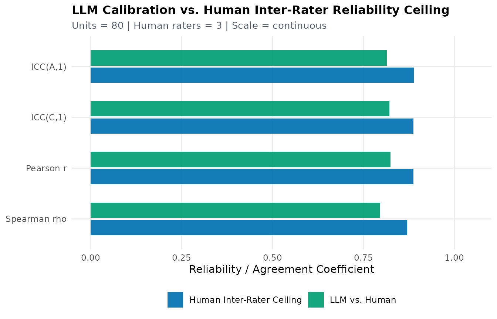
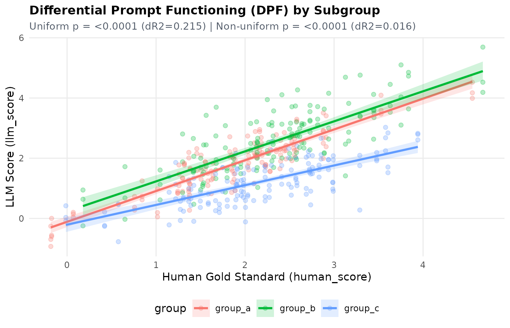
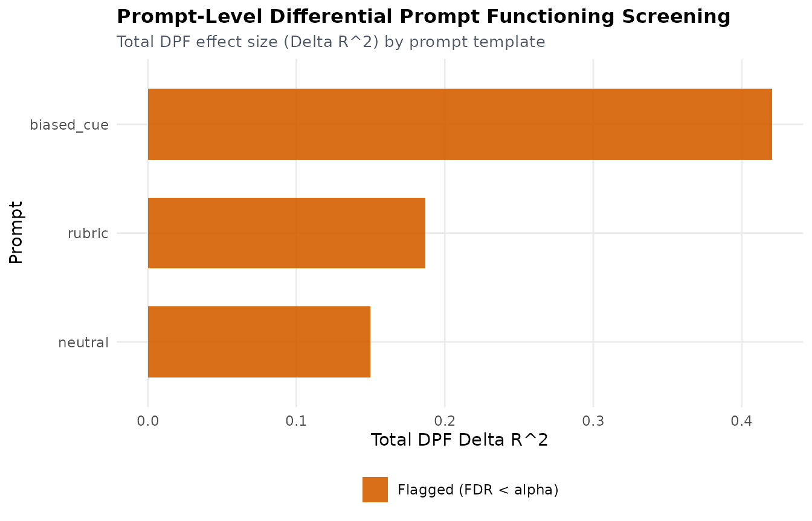
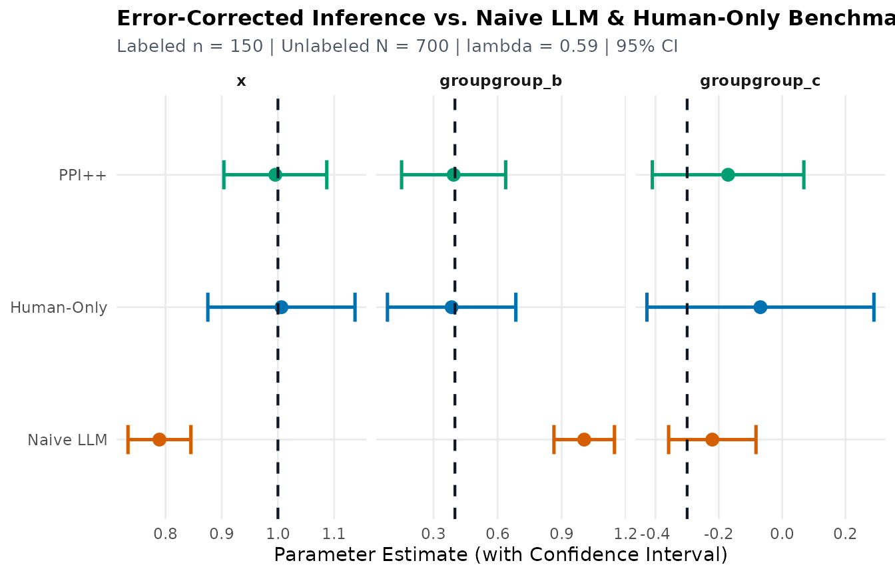

# Differential Prompt Functioning (DPF), Fairness, and Human Ceiling Benchmarks

## Why High Overall Correlation Can Still Hide Subgroup Bias

An LLM rater can achieve an impressive overall correlation
($`r > 0.85`$) with human gold-standard scores and still systematically
over- or under-score specific demographic, linguistic, or clinical
subgroups. In psychometrics, this failure of measurement invariance is
known as **Differential Item Functioning (DIF)**; when induced by prompt
wording or model behavior, `llmmetric` terms it **Differential Prompt
Functioning (DPF)**.

This vignette walks through a complete measurement-invariance and
fairness workflow:

1.  Benchmarking LLM agreement against the **human inter-rater
    reliability ceiling** via
    [`human_irr()`](https://marcusharrisphd.com/llmmetric/reference/human_irr.md).
2.  Detecting **uniform** (parallel shift) and **non-uniform** (slope
    difference) DPF across multiple subgroups via
    [`dpf_test()`](https://marcusharrisphd.com/llmmetric/reference/dpf_test.md).
3.  Pinpointing the exact biased prompt template via **prompt-level FDR
    screening** and the `prompt x group` interaction test.
4.  Mitigating residual subgroup bias in downstream regressions with
    **Prediction-Powered Inference
    ([`ppi_lm()`](https://marcusharrisphd.com/llmmetric/reference/ppi_lm.md))**
    and APA reporting via
    [`format_apa_table()`](https://marcusharrisphd.com/llmmetric/reference/format_apa_table.md).

``` r

library(llmmetric)
```

------------------------------------------------------------------------

## 1. Establishing the Human Inter-Rater Reliability Ceiling

Before judging whether an LLM’s agreement with human raters is “good
enough,” we should measure how strongly **human raters agree with each
other** on the same construct. A human-vs-human ICC of `0.86` sets a
natural ceiling on single-rater agreement.

``` r

set.seed(2026)
n_cal <- 80L
true_trait <- rnorm(n_cal, mean = 3.5, sd = 1.25)

# Three trained human coders + one LLM rater
cal_study <- tibble::tibble(
  human_1 = true_trait + rnorm(n_cal, sd = 0.42),
  human_2 = true_trait + rnorm(n_cal, sd = 0.45),
  human_3 = true_trait + rnorm(n_cal, sd = 0.40),
  llm_score = 0.20 + 0.90 * true_trait + rnorm(n_cal, sd = 0.50)
)

cal_llm <- calibration_metrics(cal_study, pred_col = "llm_score", truth_col = "human_1")
irr_ceiling <- human_irr(
  cal_study,
  rater_cols = c("human_1", "human_2", "human_3"),
  llm_calibration = cal_llm
)
irr_ceiling
#> 
#> ── Human Inter-Rater Reliability Ceiling (continuous)
#> Units: 80 | Human raters: 3 | Balanced: TRUE | Method: two_way_anova
#> ICC(A,1) = 0.889 | ICC(A,k) = 0.960 | ICC(C,1) = 0.888 | Mean r = 0.888 |
#> Pairwise RMSE = 0.589
#> LLM Calibration vs. Human Inter-Rater Ceiling:
#> # A tibble: 4 × 5
#>   metric       human_ceiling llm_vs_human     gap pct_of_ceiling
#>   <chr>                <dbl>        <dbl>   <dbl>          <dbl>
#> 1 ICC(A,1)             0.889        0.814 -0.0747           91.6
#> 2 ICC(C,1)             0.888        0.822 -0.0657           92.6
#> 3 Pearson r            0.888        0.824 -0.0636           92.8
#> 4 Spearman rho         0.870        0.796 -0.0747           91.4
```

``` r

autoplot(irr_ceiling)
```



`irr_ceiling$benchmark` directly compares LLM-human agreement against
the human-human ceiling, reporting both the raw gap and the percentage
of the human ceiling attained.

------------------------------------------------------------------------

## 2. Detecting Multi-Group Uniform and Non-Uniform DPF

Now consider a multi-prompt study spanning **three demographic/clinical
groups** (`group_a`, `group_b`, `group_c`) and **three prompt
templates** (`neutral`, `rubric`, `biased_cue`), where:

- `neutral` and `rubric` are largely invariant across subgroups, whereas
- `biased_cue` introduces a strong uniform upward shift (`+0.90`) for
  `group_b` and a modest downward shift (`-0.45`) for `group_c`,
- and an overall non-uniform slope compression affects `group_c`.

``` r

set.seed(2027)
n_u <- 150L
units <- tibble::tibble(
  unit_id = paste0("u_", sprintf("%03d", seq_len(n_u))),
  group = factor(rep(c("group_a", "group_b", "group_c"), each = n_u / 3L)),
  x = rnorm(n_u),
  true_score = 2.0 + 0.9 * rnorm(n_u) + 0.4 * (group == "group_b")
)
units$human_score <- units$true_score
units$text <- paste("Clinical reflection", seq_len(n_u))

pg_bias <- matrix(
  c(
    0.00,  0.00,  0.00,   # neutral
    0.00,  0.05, -0.05,   # rubric
    0.00,  0.90, -0.45    # biased_cue
  ),
  nrow = 3L,
  ncol = 3L,
  byrow = TRUE,
  dimnames = list(c("neutral", "rubric", "biased_cue"), c("group_a", "group_b", "group_c"))
)

des <- coding_design(
  prompts = c(
    neutral = "Score construct intensity objectively: {text}",
    rubric = "Apply anchored rubric criteria: {text}",
    biased_cue = "Evaluate emotional tone with social cues: {text}"
  ),
  models = "model_a",
  schema = coding_schema(llm_score = schema_field("numeric"))
)

be <- backend_mock(
  seed = 314,
  error_sd = 0.35,
  prompt_sd = 0.10,
  unit_prompt_sd = 0.15,
  dpf_nonuniform = c(group_c = -0.35),
  dpf_prompt_group = pg_bias
)

coded <- code_texts(units, text_col = "text", id_col = "unit_id", design = des, backend = be)

dpf_res <- dpf_test(
  coded,
  score_col = "llm_score",
  truth_col = "human_score",
  group_col = "group",
  prompt_col = "prompt",
  id_col = "unit_id"
)
dpf_res
#> 
#> ── Differential Prompt Functioning (DPF) Diagnostics
#> Family: gaussian | Reference group: "group_a" | Clustered: TRUE | DPF detected:
#> TRUE
#> # A tibble: 3 × 7
#>   test       statistic    df p_value delta_r2 magnitude  flagged
#>   <chr>          <dbl> <dbl> <chr>      <dbl> <chr>      <lgl>  
#> 1 uniform        272.      2 <0.0001    0.215 large      TRUE   
#> 2 nonuniform      29.0     2 <0.0001    0.016 negligible TRUE   
#> 3 omnibus        341.      4 <0.0001    0.231 large      TRUE
#> Per-prompt DPF screening (3 prompts):
#> # A tibble: 3 × 6
#>   prompt         n omnibus_p omnibus_p_adj delta_r2_total flagged
#>   <chr>      <int>     <dbl>         <dbl>          <dbl> <lgl>  
#> 1 biased_cue   150  2.43e-40      7.30e-40          0.420 TRUE   
#> 2 neutral      150  7.40e-16      7.40e-16          0.150 TRUE   
#> 3 rubric       150  2.91e-19      4.36e-19          0.187 TRUE
```

Notice two crucial methodological safeguards in
[`dpf_test()`](https://marcusharrisphd.com/llmmetric/reference/dpf_test.md):

1.  Because every unit was scored by 3 prompts (`id_col = "unit_id"`),
    [`dpf_test()`](https://marcusharrisphd.com/llmmetric/reference/dpf_test.md)
    automatically activates **unit-clustered sandwich Wald tests**
    (`clustered = TRUE`), preventing pseudoreplication from inflating
    Type-I error.
2.  Per-prompt screening applies **Benjamini-Hochberg FDR adjustment**
    (`omnibus_p_adj`) and runs a global `prompt x group` interaction
    test confirming that subgroup bias differs systematically across
    prompt wordings.

``` r

autoplot(dpf_res, type = "curves")
```



``` r

autoplot(dpf_res, type = "prompts")
```



Inspecting `dpf_res$prompt_interaction_test` and
`dpf_res$subgroup_summary` immediately tells the research team *which*
prompt should be dropped or revised and *which* subgroups suffer
conditional bias:

``` r

dpf_res$prompt_interaction_test
#> # A tibble: 1 × 7
#>   test           stat_type  statistic    df  p_value delta_r2 flagged
#>   <chr>          <chr>          <dbl> <int>    <dbl>    <dbl> <lgl>  
#> 1 prompt_x_group Wald_Chisq      124.     4 9.06e-26   0.0487 TRUE
dpf_res$subgroup_summary[, c("group", "n", "raw_bias", "cond_bias", "cond_slope", "rmse")]
#> # A tibble: 3 × 6
#>   group       n raw_bias cond_bias cond_slope  rmse
#>   <chr>   <int>    <dbl>     <dbl>      <dbl> <dbl>
#> 1 group_a   150  -0.0701     0          1.02  0.436
#> 2 group_b   150   0.227      0.292      0.997 0.694
#> 3 group_c   150  -0.948     -0.875      0.655 1.11
```

------------------------------------------------------------------------

## 3. Mitigating Residual Bias in Downstream Regression via PPI++

Even after dropping `biased_cue`, subtle residual calibration or
subgroup bias may persist in `rubric` and `neutral`. Suppose we score a
larger corpus ($`N = 700`$ unlabeled texts alongside $`n = 150`$
human-validated texts) and estimate group differences controlling for
covariate `x`:

``` r

set.seed(2028)
n_tot <- 850L
grp_all <- factor(sample(c("group_a", "group_b", "group_c"), n_tot, replace = TRUE))
x_all <- rnorm(n_tot)
y_all <- 2.0 + 1.0 * x_all + ifelse(grp_all == "group_b", 0.4, ifelse(grp_all == "group_c", -0.3, 0)) +
  rnorm(n_tot, sd = 0.85)
# LLM retains uniform DPF bias (+0.65 on group_b) and slope compression
llm_all <- 0.3 + 0.85 * y_all + ifelse(grp_all == "group_b", 0.65, 0) + rnorm(n_tot, sd = 0.45)

study_df <- tibble::tibble(
  x = x_all,
  group = grp_all,
  human_score = c(y_all[1:150], rep(NA_real_, n_tot - 150L)),
  llm_score = llm_all
)

fit_ppi <- ppi_lm(human_score ~ x + group, data = study_df, pred_col = "llm_score")
format_apa_table(fit_ppi, include_intercept = FALSE)
#> **Comparison of Naive LLM, Human-Only, and PPI++ Parameter Estimates**
#> 
#> | Term | Estimator | Estimate | SE | 95% CI | p | Eff. Gain |
#> | --- | --- | --- | --- | --- | --- | --- |
#> | x | Naive LLM | 0.789 | 0.029 | [0.733, 0.845] | &lt; .001 | -- |
#> | x | Human-Only | 1.006 | 0.067 | [0.875, 1.137] | &lt; .001 | 1.00x |
#> | x | PPI++ | 0.995 | 0.047 | [0.904, 1.087] | &lt; .001 | 2.05x |
#> | groupgroup_b | Naive LLM | 1.006 | 0.072 | [0.864, 1.148] | &lt; .001 | -- |
#> | groupgroup_b | Human-Only | 0.385 | 0.153 | [0.084, 0.685] | .012 | 1.00x |
#> | groupgroup_b | PPI++ | 0.394 | 0.124 | [0.150, 0.638] | .002 | 1.52x |
#> | groupgroup_c | Naive LLM | -0.221 | 0.070 | [-0.358, -0.083] | .002 | -- |
#> | groupgroup_c | Human-Only | -0.069 | 0.183 | [-0.427, 0.290] | .707 | 1.00x |
#> | groupgroup_c | PPI++ | -0.171 | 0.122 | [-0.410, 0.068] | .162 | 2.25x |
#> 
#> *Note.* Labeled validation n = 150; unlabeled LLM N = 700; power-tuning lambda = 0.595. Eff. Gain denotes variance reduction (effective sample-size multiplier) relative to Human-Only.
```

``` r

autoplot(fit_ppi, true_values = c(x = 1.0, groupgroup_b = 0.4, groupgroup_c = -0.3))
```



While **Naive LLM** severely overestimates the `group_b` difference due
to DPF (`~0.98` vs. true `0.40`), **PPI++** completely removes the
subgroup bias while tightening confidence intervals compared to using
the 150 human annotations alone.
