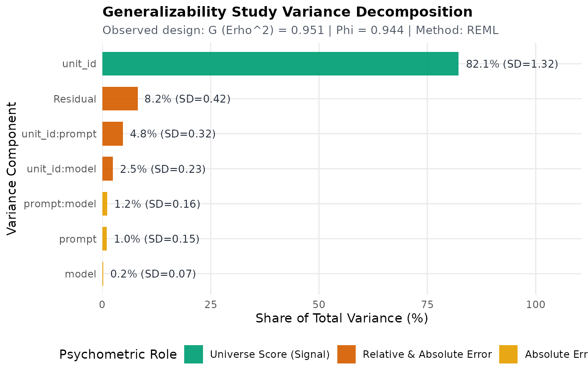
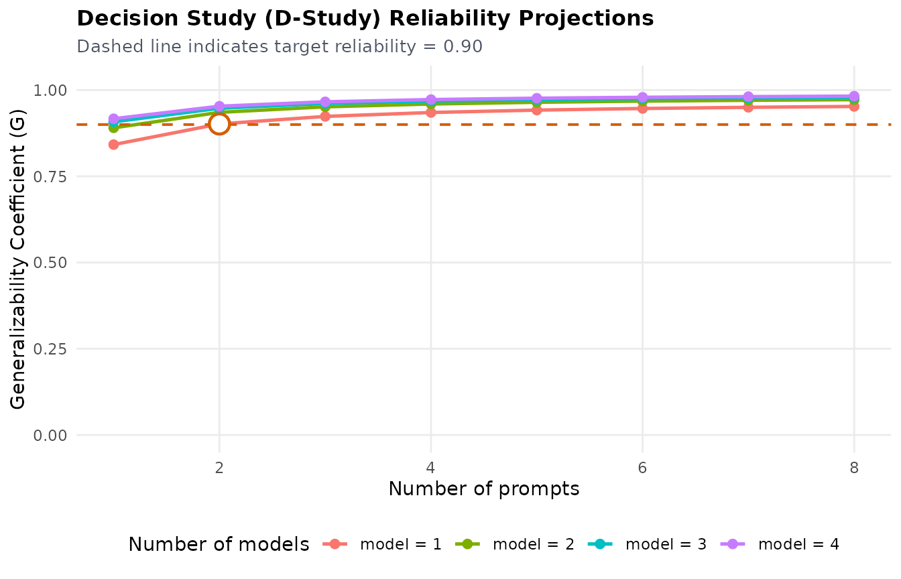
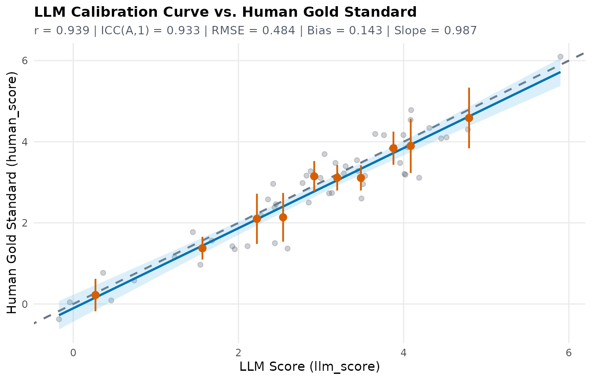
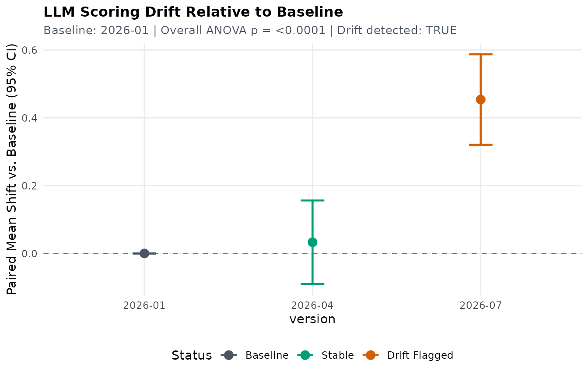
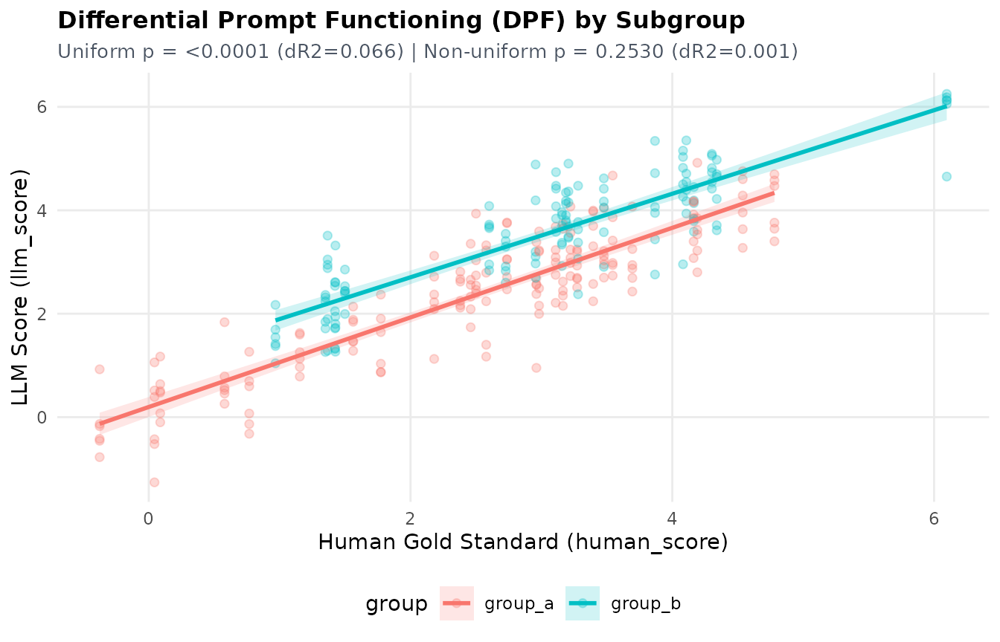
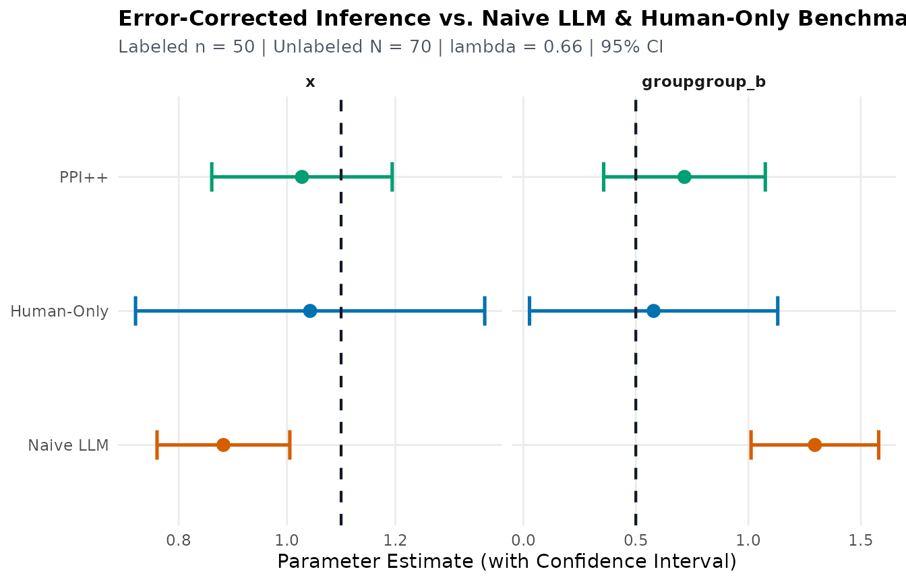

# Treating LLMs as Measurement Instruments: Getting Started with llmmetric

## Why Treat LLMs as Psychometric Measurement Instruments?

When researchers use large language models (LLMs) to code open-ended
survey responses, therapy transcripts, or daily ecological momentary
assessment (EMA) diaries into quantitative scores, the resulting
variables behave like ratings from fallible human judges—except with new
error sources:

1.  **Facet variance:** scores fluctuate across prompt wordings, model
    families, and sampling temperatures.
2.  **Miscalibration & drift:** LLM scores may exhibit scale
    compression, intercept shifts, or temporal drift across API updates.
3.  **Differential Prompt Functioning (DPF):** a prompt may
    systematically over- or under-score specific demographic or
    experimental subgroups conditional on true human ratings.
4.  **Invalid downstream inference:** plugging biased or noisy LLM
    scores directly into regressions or multilevel models produces
    biased slopes and anti-conservative confidence intervals.

`llmmetric` addresses all four issues in one cohesive workflow.

``` r

library(llmmetric)
```

------------------------------------------------------------------------

## 1. Multi-Facet Structured Coding with Caching & Schema Validation

In production you plug in
[`backend_openai()`](https://marcusharrisphd.com/llmmetric/reference/backend_openai.md)
(any OpenAI-compatible HTTP endpoint) or
[`backend_ollama()`](https://marcusharrisphd.com/llmmetric/reference/backend_ollama.md)
(local Ollama models). For offline reproducibility, prototyping, and
power analysis, `llmmetric` provides
[`backend_mock()`](https://marcusharrisphd.com/llmmetric/reference/backend_mock.md)—a
deterministic synthetic LLM rater parameterized by explicit variance
components, calibration bias, subgroup DPF, and drift.

``` r

# Define a strict JSON output schema
schema <- coding_schema(
  llm_score = schema_field("numeric", min = -6, max = 12, description = "Emotional distress rating"),
  severity  = schema_field("factor", levels = c("low", "moderate", "high"))
)

# Specify a crossed 3 prompts x 2 models coding design
design <- coding_design(
  prompts = c(
    direct = "Rate the speaker's emotional distress: {text}",
    rubric = "Apply the clinical distress rubric to score: {text}",
    cot    = "Identify emotional cues step by step, then score: {text}"
  ),
  models = c("model_a", "model_b"),
  temperatures = 0,
  schema = schema
)

# Sample corpus with unit-level covariates and human validation subset
set.seed(2026)
corpus <- tibble::tibble(
  unit_id = paste0("u_", sprintf("%03d", 1:60)),
  group = factor(rep(c("group_a", "group_b"), each = 30)),
  true_score = rnorm(60, mean = 3.0, sd = 1.2),
  text = paste("Diary reflection number", 1:60)
)
corpus$human_score <- ifelse(seq_len(60) <= 30, corpus$true_score, NA_real_)

# Execute with content-addressed memory cache and synthetic rater
cache <- coding_cache("memory")
backend <- backend_mock(
  seed = 101,
  intercept = 0.35,
  true_score_slope = 0.85,
  error_sd = 0.40,
  prompt_sd = 0.30,
  model_sd = 0.25,
  unit_prompt_sd = 0.30,
  unit_model_sd = 0.25,
  dpf_uniform = c(group_b = 0.65)
)

coded <- code_texts(
  data = corpus,
  text_col = "text",
  id_col = "unit_id",
  design = design,
  backend = backend,
  cache = cache
)
coded
#> 
#> ── LLM Coded Data (default_design)
#> Units: 60 | Rows: 360 | Valid: 360/360 | Failures: 0
#> Cache (memory): 0 hits, 360 misses
#> # A tibble: 360 × 13
#>   unit_id prompt model   temperature replicate llm_score severity cache_hit
#>   <chr>   <chr>  <chr>         <dbl>     <int>     <dbl> <fct>    <lgl>    
#> 1 u_001   direct model_a           0         1     3.72  high     FALSE    
#> 2 u_002   direct model_a           0         1     2.65  high     FALSE    
#> 3 u_003   direct model_a           0         1     2.85  high     FALSE    
#> 4 u_004   direct model_a           0         1     2.73  high     FALSE    
#> 5 u_005   direct model_a           0         1     3.03  high     FALSE    
#> 6 u_006   direct model_a           0         1     0.595 moderate FALSE    
#> # ℹ 354 more rows
#> # ℹ 5 more variables: attempts <int>, valid <lgl>, group <fct>,
#> #   true_score <dbl>, human_score <dbl>

# Re-running against the same cache produces 100% cache hits
coded_cached <- code_texts(
  data = corpus,
  text_col = "text",
  id_col = "unit_id",
  design = design,
  backend = backend,
  cache = cache
)
coded_cached$cache_stats
#> $type
#> [1] "memory"
#> 
#> $dir
#> NULL
#> 
#> $hits
#> [1] 360
#> 
#> $misses
#> [1] 360
#> 
#> $writes
#> [1] 360
#> 
#> $evictions
#> [1] 0
#> 
#> $entries
#> [1] 360
```

------------------------------------------------------------------------

## 2. Generalizability Theory: G-Study and D-Study

Let’s inspect the built-in `ema_coded` dataset (120 EMA diary entries
nested within 30 participants, scored across 3 prompts $`\times`$ 2
models = 720 codings, with 50 human-validated entries).

``` r

data(ema_coded)

g <- g_study(ema_coded, score_col = "llm_score", facets = c("prompt", "model"))
g
#> 
#> ── Generalizability Study (G-Study)
#> Units (unit_id): 120 | Facets: prompt=3, model=2 | Method: REML | Balanced:
#> TRUE
#> Observed design: G (Erho^2) = 0.951 | Phi = 0.944 | SEM(rel) = 0.298, SEM(abs)
#> = 0.321
#> Single-facet (n=1): G = 0.842 | Phi = 0.821
#> # A tibble: 7 × 5
#>   component      variance     sd pct_total role                 
#>   <chr>             <dbl>  <dbl>     <dbl> <chr>                
#> 1 unit_id          1.74   1.32       82.1  universe             
#> 2 prompt           0.0219 0.148       1.03 absolute_only        
#> 3 model            0.005  0.0708      0.24 absolute_only        
#> 4 unit_id:prompt   0.101  0.318       4.78 relative_and_absolute
#> 5 unit_id:model    0.0525 0.229       2.48 relative_and_absolute
#> 6 prompt:model     0.0249 0.158       1.17 absolute_only        
#> 7 Residual         0.173  0.416       8.16 relative_and_absolute
```

``` r

autoplot(g)
```



Next, use
[`d_study()`](https://marcusharrisphd.com/llmmetric/reference/d_study.md)
to answer a core research design question: *How many prompt paraphrases
and models do we need to achieve reliability $`E\rho^2 \ge 0.90`$ at
minimum cost?*

``` r

d <- d_study(g, grid = list(prompt = 1:8, model = 1:4), target = 0.90, metric = "g")
d
#> 
#> ── Decision Study (D-Study) Projections
#> Evaluated 32 designs | Target: G (Erho^2) >= 0.90
#> Lowest-cost recommended design: prompt=2, model=1 (2 calls/unit -> G = 0.902,
#> Phi = 0.889)
#> # A tibble: 2 × 10
#>   prompt model n_replicates total_calls  cost g_coef phi_coef sem_relative
#>    <int> <int>        <int>       <dbl> <dbl>  <dbl>    <dbl>        <dbl>
#> 1      2     1            1           2     2  0.902    0.889        0.436
#> 2      1     3            1           3     3  0.908    0.893        0.420
#> # ℹ 2 more variables: sem_absolute <dbl>, meets_target <lgl>
d$asymptotes
#> # A tibble: 2 × 5
#>   facet_to_inf g_ceiling_others_1 phi_ceiling_others_1 g_ceiling_others_obs
#>   <chr>                     <dbl>                <dbl>                <dbl>
#> 1 prompt                    0.971                0.968                0.985
#> 2 model                     0.945                0.934                0.981
#> # ℹ 1 more variable: phi_ceiling_others_obs <dbl>
```

``` r

autoplot(d)
```



------------------------------------------------------------------------

## 3. Calibration vs. Human Gold Standards & Drift Monitoring

Collapsing multi-facet ratings to unit-level composites via
[`aggregate_scores()`](https://marcusharrisphd.com/llmmetric/reference/aggregate_scores.md)
lets us evaluate agreement, bias, dispersion, and calibration curves
against human ratings:

``` r

unit_df <- aggregate_scores(ema_coded, score_col = "llm_score", id_col = "unit_id")

cal <- calibration_metrics(unit_df, pred_col = "llm_score", truth_col = "human_score")
cal
#> 
#> ── LLM Calibration Diagnostics (continuous)
#> Prediction: "llm_score" vs Human Gold Standard: "human_score" (n = 50)
#> r = 0.939 | rho = 0.900 | CCC = 0.932 | ICC(A,1) = 0.933
#> MAE = 0.394 | RMSE = 0.484 | Bias = 0.143 | Cal Slope = 0.987, Intercept =
#> -0.106 (p = 0.1095)
```

``` r

autoplot(cal)
```



When an API provider silently updates a model checkpoint or you score
new longitudinal waves,
[`check_drift()`](https://marcusharrisphd.com/llmmetric/reference/check_drift.md)
audits stability on a fixed anchor set of texts:

``` r

set.seed(15)
anchor_units <- paste0("anchor_", 1:40)
anchor_base <- rnorm(40, mean = 3.0, sd = 1.1)
anchor_df <- tibble::tibble(
  unit_id = rep(anchor_units, 3),
  version = rep(c("2026-01", "2026-04", "2026-07"), each = 40),
  score = rep(anchor_base, 3) + rep(c(0, 0.04, 0.55), each = 40) + rnorm(120, sd = 0.25)
)

drift_res <- check_drift(anchor_df, score_col = "score", version_col = "version")
drift_res
#> 
#> ── LLM Scoring Drift Diagnostics
#> Baseline: "2026-01" | Overall ANOVA F(2, 78) = 35.568, p = <0.0001
#> Drift detected (alpha=0.05, |d_z|>=0.2): TRUE
#> # A tibble: 3 × 7
#>   version n_shared mean_diff cohens_dz   icc p_adj drift_flag
#>   <chr>      <int>     <dbl>     <dbl> <dbl> <dbl> <lgl>     
#> 1 2026-01       40     0         0     1     1     FALSE     
#> 2 2026-04       40     0.033     0.086 0.922 0.590 FALSE     
#> 3 2026-07       40     0.454     1.09  0.822 0     TRUE
autoplot(drift_res)
```



------------------------------------------------------------------------

## 4. Differential Prompt Functioning (DPF) & Fairness Diagnostics

High overall correlation with human scores can still mask systematic
subgroup bias.
[`dpf_test()`](https://marcusharrisphd.com/llmmetric/reference/dpf_test.md)
adapts nested DIF regression models to test **uniform** (parallel
intercept shift) and **non-uniform** (slope difference) bias conditional
on human gold-standard scores—using unit-clustered sandwich tests
automatically when units appear across multiple prompts:

``` r

dpf <- dpf_test(
  ema_coded,
  score_col = "llm_score",
  truth_col = "human_score",
  group_col = "group",
  prompt_col = "prompt",
  id_col = "unit_id"
)
dpf
#> 
#> ── Differential Prompt Functioning (DPF) Diagnostics
#> Family: gaussian | Reference group: "group_a" | Clustered: TRUE | DPF detected:
#> TRUE
#> # A tibble: 3 × 7
#>   test       statistic    df p_value delta_r2 magnitude  flagged
#>   <chr>          <dbl> <dbl> <chr>      <dbl> <chr>      <lgl>  
#> 1 uniform        91.9      1 <0.0001   0.066  moderate   TRUE   
#> 2 nonuniform      1.31     1 0.2530    0.0007 negligible FALSE  
#> 3 omnibus        90.4      2 <0.0001   0.0667 moderate   TRUE
#> Per-prompt DPF screening (3 prompts):
#> # A tibble: 3 × 6
#>   prompt     n omnibus_p omnibus_p_adj delta_r2_total flagged
#>   <chr>  <int>     <dbl>         <dbl>          <dbl> <lgl>  
#> 1 cot      100  1.67e-11      5.02e-11         0.104  TRUE   
#> 2 direct   100  6.72e-11      1.01e-10         0.0942 TRUE   
#> 3 rubric   100  3.03e- 3      3.03e- 3         0.0226 TRUE
```

``` r

autoplot(dpf, type = "curves")
```



Notice that
[`dpf_test()`](https://marcusharrisphd.com/llmmetric/reference/dpf_test.md)
clearly separates the injected uniform subgroup bias
(`uniform p < 0.0001`) from non-uniform slope bias
(`nonuniform p > 0.20`), and flags every prompt exhibiting bias after
Benjamini-Hochberg FDR control.

------------------------------------------------------------------------

## 5. Error-Corrected Downstream Inference (PPI++ & Multilevel `ppi_lmer`)

Because `ema_coded` exhibits both calibration distortion and uniform
subgroup bias for `group_b`, plugging `llm_score` directly into
[`lm()`](https://rdrr.io/r/stats/lm.html) biases the estimated group
difference.

Using
[`ppi_lm()`](https://marcusharrisphd.com/llmmetric/reference/ppi_lm.md)
and
[`ppi_lmer()`](https://marcusharrisphd.com/llmmetric/reference/ppi_lmer.md),
we combine the 50 human-validated entries with the 70 unlabeled
LLM-coded entries to obtain **provably unbiased estimates, valid 95%
confidence intervals, and narrower standard errors than using the 50
human ratings alone**:

``` r

fit_lm <- ppi_lm(human_score ~ x + group, data = unit_df, pred_col = "llm_score")
summary(fit_lm)
#> 
#> ── Prediction-Powered Inference (ppi++)
#> Labeled n = 50 | Unlabeled N = 70 | lambda = 0.664 | CI = 95%
#> # A tibble: 3 × 7
#>   term         estimate std_error conf_low conf_high p_value var_gain
#>   <chr>           <dbl>     <dbl>    <dbl>     <dbl> <chr>      <dbl>
#> 1 (Intercept)     2.50      0.127    2.25       2.75 <0.0001     1.95
#> 2 x               1.03      0.085    0.861      1.19 <0.0001     3.75
#> 3 groupgroup_b    0.716     0.183    0.357      1.08 <0.0001     2.36
#> Benchmarks (PPI vs Human-Only vs Naive LLM):
#> # A tibble: 9 × 7
#>   method     term         estimate std_error conf_low conf_high p_value
#>   <chr>      <chr>           <dbl>     <dbl>    <dbl>     <dbl> <chr>  
#> 1 ppi++      (Intercept)     2.50     0.127    2.25        2.75 <0.0001
#> 2 ppi++      x               1.03     0.085    0.861       1.19 <0.0001
#> 3 ppi++      groupgroup_b    0.716    0.183    0.357       1.08 <0.0001
#> 4 human_only (Intercept)     2.53     0.177    2.18        2.87 <0.0001
#> 5 human_only x               1.04     0.164    0.720       1.37 <0.0001
#> 6 human_only groupgroup_b    0.579    0.281    0.0276      1.13 0.0396 
#> 7 naive_llm  (Intercept)     2.34     0.0991   2.14        2.53 <0.0001
#> 8 naive_llm  x               0.883    0.0626   0.76        1.01 <0.0001
#> 9 naive_llm  groupgroup_b    1.30     0.145    1.01        1.58 <0.0001
```

``` r

autoplot(fit_lm, true_values = c(x = 1.1, groupgroup_b = 0.5))
```



Because EMA diary entries are nested within 30 participants (`cluster`),
[`ppi_lmer()`](https://marcusharrisphd.com/llmmetric/reference/ppi_lmer.md)
incorporates random-intercept variance components and cluster-robust
PPI++ sandwich standard errors:

``` r

fit_ml <- ppi_lmer(human_score ~ x + group + (1 | cluster), data = unit_df, pred_col = "llm_score")
fit_ml
#> 
#> ── Prediction-Powered Inference (ppi++_clustered)
#> Labeled n = 50 | Unlabeled N = 70 | lambda = 0.604 | CI = 95%
#> Clusters (cluster): 25 labeled, 29 unlabeled (30 total; overlapping)
#> Random-intercept REML (human): tau2 = 0.786, sigma2 = 0.257, ICC = 0.754 |
#> Weighting: gls_cluster_size_weighted
#> # A tibble: 3 × 7
#>   term         estimate std_error conf_low conf_high p_value var_gain
#>   <chr>           <dbl>     <dbl>    <dbl>     <dbl> <chr>      <dbl>
#> 1 (Intercept)     2.50     0.153     2.19       2.82 <0.0001     1.53
#> 2 x               1.03     0.0868    0.852      1.21 <0.0001     4.27
#> 3 groupgroup_b    0.705    0.168     0.361      1.05 0.0002      2.08
```

See
[`vignette("ppi-coverage-proof", package = "llmmetric")`](https://marcusharrisphd.com/llmmetric/articles/ppi-coverage-proof.md)
for a formal Monte Carlo proof comparing empirical 95% confidence
interval coverage across Naive LLM, Human-Only, PPI, and PPI++
estimators.
