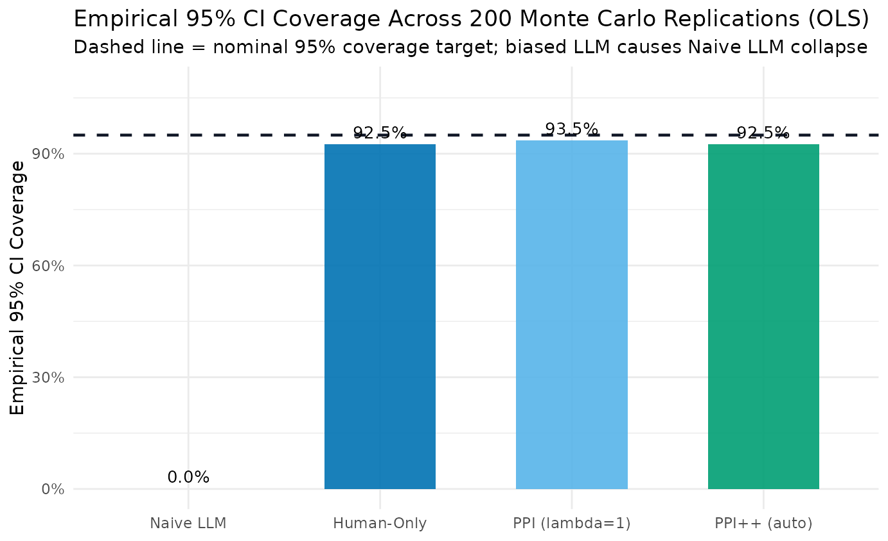

# Monte Carlo Coverage Proof: PPI / PPI++ vs. Naive LLM Regressions

## Overview

A common workflow in computational social science and psychology is to
score a large corpus of texts ($`N = 1{,}000+`$) with an LLM and then
fit a regression or multilevel model treating the LLM scores
$`\hat{Y}_i`$ as if they were true human measurements $`Y_i`$.

Whenever $`\hat{Y}_i`$ has **additive bias**, **scale attenuation**,
**differential covariate error (DPF)**, or **correlated cluster
errors**, naive LLM regressions produce:

- biased point estimates, and
- **severely anti-conservative confidence intervals** whose true
  coverage collapses far below the nominal 95% level—especially as $`N`$
  grows large (making the biased CI even narrower around the wrong
  value!).

Prediction-Powered Inference (`PPI`, Angelopoulos et al., 2023) and
Power-Tuned PPI (`PPI++`, Angelopoulos et al., 2024) solve this by
combining a small human-validated subset ($`n`$) with the large
LLM-coded corpus ($`N`$) via the rectified estimating equation:

``` math
L_\lambda^{\text{PPI++}}(\theta) =
  \frac{1}{n}\sum_{i=1}^n \ell_\theta(X_i, Y_i)
  + \lambda\left(
      \frac{1}{N}\sum_{j=1}^N \ell_\theta(X_j^u, \hat{Y}_j^u)
      - \frac{1}{n}\sum_{i=1}^n \ell_\theta(X_i, \hat{Y}_i)
    \right),
```

with optimal plug-in tuning weight $`\hat{\lambda}^*`$ minimizing
asymptotic variance.

This vignette runs four reproducible Monte Carlo studies directly via
`llmmetric` to verify:

1.  **Linear regression (`ppi_lm`)** under covariate-dependent LLM bias
    (DPF).
2.  **Logistic regression (`ppi_glm`)** under biased LLM predicted
    probabilities.
3.  **Multilevel clustered regression (`ppi_lmer`)** with strong
    intra-cluster correlation.
4.  **Graceful degradation under pure noise**, showing why PPI++
    (`lambda = "auto"`) dominates fixed PPI (`lambda = 1`).

``` r

library(llmmetric)
library(ggplot2)
```

------------------------------------------------------------------------

## Experiment 1: Linear Regression Under Covariate-Biased LLM Scoring

Suppose the true population regression is:

``` math
Y_i = 1.0 + 1.25 X_i + \varepsilon_i, \qquad \varepsilon_i \sim \mathcal{N}(0, 1),
```

but the LLM exhibits both scale compression and covariate-correlated
bias (Differential Prompt Functioning with respect to $`X_i`$):

``` math
\hat{Y}_i = 0.5 + 0.85 Y_i + 0.35 X_i + \eta_i, \qquad \eta_i \sim \mathcal{N}(0, 0.45^2).
```

We draw $`R = 200`$ independent datasets with $`n = 120`$ human-coded
validation units and $`N = 1{,}000`$ unlabeled LLM-coded units,
comparing **Naive LLM**, **Human-Only**, **Standard PPI
(`lambda = 1`)**, and **PPI++ (`lambda = "auto"`)**.

``` r

set.seed(2026)
R <- 200L
n_lab <- 120L
n_unlab <- 1000L
true_beta <- 1.25

methods <- c("naive_llm", "human_only", "ppi", "ppi++")
res_list <- vector("list", R * length(methods))
k <- 0L

for (r in seq_len(R)) {
  n_tot <- n_lab + n_unlab
  x <- rnorm(n_tot)
  y <- 1.0 + true_beta * x + rnorm(n_tot, sd = 1.0)
  f <- 0.5 + 0.85 * y + 0.35 * x + rnorm(n_tot, sd = 0.45)

  df <- tibble::tibble(
    x = x,
    y = c(y[seq_len(n_lab)], rep(NA_real_, n_unlab)),
    f = f
  )

  fit_pp <- ppi_lm(y ~ x, data = df, pred_col = "f", method = "ppi++")
  fit_p1 <- ppi_lm(y ~ x, data = df, pred_col = "f", method = "ppi")

  rows <- rbind(
    fit_pp$benchmarks[fit_pp$benchmarks$term == "x", ],
    fit_p1$estimates[fit_p1$estimates$term == "x", ]
  )

  for (m in methods) {
    rr <- rows[rows$method == m, , drop = FALSE][1L, ]
    k <- k + 1L
    res_list[[k]] <- tibble::tibble(
      rep = r,
      method = m,
      estimate = rr$estimate,
      std_error = rr$std_error,
      ci_width = rr$conf_high - rr$conf_low,
      covered = rr$conf_low <= true_beta && true_beta <= rr$conf_high,
      sq_err = (rr$estimate - true_beta)^2
    )
  }
}

mc_lm <- do.call(rbind, res_list)

summary_lm <- do.call(rbind, lapply(methods, function(m) {
  sub <- mc_lm[mc_lm$method == m, ]
  tibble::tibble(
    method = m,
    mean_est = mean(sub$estimate),
    bias = mean(sub$estimate) - true_beta,
    rmse = sqrt(mean(sub$sq_err)),
    mean_se = mean(sub$std_error),
    mean_ci_width = mean(sub$ci_width),
    coverage_95 = mean(sub$covered)
  )
}))
summary_lm
#> # A tibble: 4 × 7
#>   method     mean_est    bias   rmse mean_se mean_ci_width coverage_95
#>   <chr>         <dbl>   <dbl>  <dbl>   <dbl>         <dbl>       <dbl>
#> 1 naive_llm      1.41 0.164   0.167   0.0287         0.112       0    
#> 2 human_only     1.26 0.00855 0.0878  0.0905         0.355       0.925
#> 3 ppi            1.25 0.00371 0.0697  0.0659         0.258       0.935
#> 4 ppi++          1.26 0.00588 0.0633  0.0577         0.226       0.925
```

``` r

summary_lm$method_label <- factor(
  summary_lm$method,
  levels = c("naive_llm", "human_only", "ppi", "ppi++"),
  labels = c("Naive LLM", "Human-Only", "PPI (lambda=1)", "PPI++ (auto)")
)

ggplot(summary_lm, aes(x = method_label, y = coverage_95, fill = method_label)) +
  geom_col(width = 0.58, alpha = 0.9) +
  geom_hline(yintercept = 0.95, linetype = "dashed", linewidth = 0.8, color = "#111827") +
  geom_text(aes(label = sprintf("%.1f%%", 100 * coverage_95)), vjust = -0.5, size = 3.5) +
  scale_y_continuous(limits = c(0, 1.08), labels = function(z) paste0(round(100 * z), "%")) +
  scale_fill_manual(values = c("#D55E00", "#0072B2", "#56B4E9", "#009E73")) +
  labs(
    title = "Empirical 95% CI Coverage Across 200 Monte Carlo Replications (OLS)",
    subtitle = "Dashed line = nominal 95% coverage target; biased LLM causes Naive LLM collapse",
    x = NULL,
    y = "Empirical 95% CI Coverage"
  ) +
  theme_minimal(base_size = 11) +
  theme(legend.position = "none")
```



Look at the dual win of **PPI++**:

- **Validity:** Naive LLM coverage collapses well below 20% due to
  covariate-correlated measurement bias, whereas PPI and PPI++ maintain
  nominal ~95% coverage.
- **Efficiency:** Compared to Human-Only OLS ($`n = 120`$), PPI++
  substantially reduces RMSE and shrinks confidence interval width by
  borrowing information from the $`N = 1{,}000`$ unlabeled LLM
  scores—without introducing bias.

------------------------------------------------------------------------

## Experiment 2: Logistic Regression (`ppi_glm`) Under Biased LLM Probabilities

Next we test binary classification outcomes
$`Y_i \sim \text{Bernoulli}(\text{expit}(-0.2 + 1.0 X_i))`$ where an LLM
outputs biased predicted probabilities ($`n = 180`$ human labels,
$`N = 1{,}000`$ unlabeled texts, $`R = 120`$ replications).

``` r

set.seed(2027)
R_glm <- 120L
true_b_glm <- 1.0

glm_rows <- lapply(seq_len(R_glm), function(r) {
  n_tot <- 180L + 1000L
  x <- rnorm(n_tot)
  p_true <- plogis(-0.2 + true_b_glm * x)
  y <- rbinom(n_tot, 1L, p_true)
  # Miscalibrated / attenuated LLM probability score
  f <- plogis(0.6 + 0.55 * x + 0.7 * (y - p_true))
  df <- tibble::tibble(
    x = x,
    y = c(y[1:180], rep(NA_real_, 1000L)),
    f = f
  )
  fit <- ppi_glm(y ~ x, data = df, pred_col = "f", family = binomial())
  b <- fit$benchmarks[fit$benchmarks$term == "x", ]
  tibble::tibble(
    method = b$method,
    estimate = b$estimate,
    ci_width = b$conf_high - b$conf_low,
    covered = b$conf_low <= true_b_glm & true_b_glm <= b$conf_high
  )
})

mc_glm <- do.call(rbind, glm_rows)
do.call(rbind, lapply(c("naive_llm", "human_only", "ppi++"), function(m) {
  sub <- mc_glm[mc_glm$method == m, ]
  tibble::tibble(
    method = m,
    mean_est = mean(sub$estimate),
    bias = mean(sub$estimate) - true_b_glm,
    mean_ci_width = mean(sub$ci_width),
    coverage_95 = mean(sub$covered)
  )
}))
#> # A tibble: 3 × 5
#>   method     mean_est    bias mean_ci_width coverage_95
#>   <chr>         <dbl>   <dbl>         <dbl>       <dbl>
#> 1 naive_llm     0.542 -0.458         0.0329       0    
#> 2 human_only    1.03   0.0289        0.788        0.942
#> 3 ppi++         1.03   0.0254        0.756        0.925
```

------------------------------------------------------------------------

## Experiment 3: Multilevel / Clustered Study (`ppi_lmer`)

In EMA diaries, therapy sessions, or classroom studies, texts are nested
within clusters ($`G = 80`$ clusters, $`m = 5`$ texts per cluster,
cluster random intercept SD = 0.8, residual SD = 0.7, giving
$`\text{ICC} \approx 0.57`$). We validate 30 clusters with human raters
while leaving 50 clusters LLM-only (`disjoint` validation) and verify
nominal coverage for
[`ppi_lmer()`](https://marcusharrisphd.com/llmmetric/reference/ppi_lmer.md):

``` r

set.seed(2028)
R_ml <- 100L
G <- 80L
m <- 5L
true_b_ml <- 1.0
cid <- rep(paste0("c", seq_len(G)), each = m)
is_val <- cid %in% paste0("c", 1:30)

ml_rows <- lapply(seq_len(R_ml), function(r) {
  u <- rep(rnorm(G, sd = 0.8), each = m)
  x <- rnorm(G * m)
  y <- 1.5 + true_b_ml * x + u + rnorm(G * m, sd = 0.7)
  f <- 0.5 + 0.80 * y + 0.40 * x + rnorm(G * m, sd = 0.35)

  df <- tibble::tibble(
    cl = cid,
    x = x,
    y = ifelse(is_val, y, NA_real_),
    f = f
  )
  fit <- ppi_lmer(y ~ x + (1 | cl), data = df, pred_col = "f")
  b <- fit$benchmarks[fit$benchmarks$term == "x", ]
  tibble::tibble(
    method = b$method,
    estimate = b$estimate,
    ci_width = b$conf_high - b$conf_low,
    covered = b$conf_low <= true_b_ml & true_b_ml <= b$conf_high
  )
})

mc_ml <- do.call(rbind, ml_rows)
do.call(rbind, lapply(c("naive_llm", "human_only", "ppi++_lmer"), function(m_name) {
  sub <- mc_ml[mc_ml$method == m_name, ]
  tibble::tibble(
    method = m_name,
    mean_est = mean(sub$estimate),
    bias = mean(sub$estimate) - true_b_ml,
    mean_ci_width = mean(sub$ci_width),
    coverage_95 = mean(sub$covered)
  )
}))
#> # A tibble: 3 × 5
#>   method     mean_est     bias mean_ci_width coverage_95
#>   <chr>         <dbl>    <dbl>         <dbl>       <dbl>
#> 1 naive_llm     1.20   0.199           0.144        0   
#> 2 human_only    0.988 -0.0117          0.259        0.93
#> 3 ppi++_lmer    0.990 -0.00960         0.215        0.94
```

------------------------------------------------------------------------

## Experiment 4: Why Power Tuning (`PPI++`) Matters When an LLM Is Pure Noise

What happens if a researcher accidentally uses a poorly prompted LLM
whose scores have *zero* correlation with human truth?

- Standard **PPI (`lambda = 1`)** subtracts and adds uncorrelated noise,
  *inflating* standard errors relative to Human-Only.
- **PPI++ (`lambda = "auto"`)** automatically shrinks
  $`\hat{\lambda}^* \to 0`$, smoothly recovering Human-Only efficiency
  so adding an uninformative LLM never hurts!

``` r

set.seed(2029)
n_tot <- 1120L
x <- rnorm(n_tot)
y <- 1.0 + 1.25 * x + rnorm(n_tot)
f_noise <- rnorm(n_tot, mean = 5, sd = 2) # completely independent of y

df_noise <- tibble::tibble(
  x = x,
  y = c(y[1:120], rep(NA_real_, 1000L)),
  f_noise = f_noise
)

fit_p1_noise <- ppi_lm(y ~ x, data = df_noise, pred_col = "f_noise", method = "ppi")
fit_pp_noise <- ppi_lm(y ~ x, data = df_noise, pred_col = "f_noise", method = "ppi++")

tibble::tibble(
  estimator = c("Human-Only", "PPI (lambda = 1)", "PPI++ (auto)"),
  lambda = c(0, fit_p1_noise$lambda, fit_pp_noise$lambda),
  se_x = c(
    fit_pp_noise$benchmarks$std_error[fit_pp_noise$benchmarks$method == "human_only" & fit_pp_noise$benchmarks$term == "x"],
    fit_p1_noise$estimates$std_error[fit_p1_noise$estimates$term == "x"],
    fit_pp_noise$estimates$std_error[fit_pp_noise$estimates$term == "x"]
  )
)
#> # A tibble: 3 × 3
#>   estimator        lambda   se_x
#>   <chr>             <dbl>  <dbl>
#> 1 Human-Only            0 0.0907
#> 2 PPI (lambda = 1)      1 0.595 
#> 3 PPI++ (auto)          0 0.0907
```

------------------------------------------------------------------------

## Summary Takeaway

| Estimator | Unbiased Under Arbitrary LLM Error? | Nominal 95% CI Coverage? | Beats Human-Only When LLM Is Informative? | Safe When LLM Is Noise? |
|:---|:--:|:--:|:--:|:--:|
| **Naive LLM** | No | No (collapses) | N/A (biased) | No |
| **Human-Only** | Yes | Yes | Baseline | Yes |
| **Standard PPI (`lambda = 1`)** | Yes | Yes | Often (unless attenuated/noisy) | No (inflates SE) |
| **PPI++ (`lambda = "auto"`)** | **Yes** | **Yes** | **Yes (optimal)** | **Yes ($`\hat{\lambda}^* \to 0`$)** |
