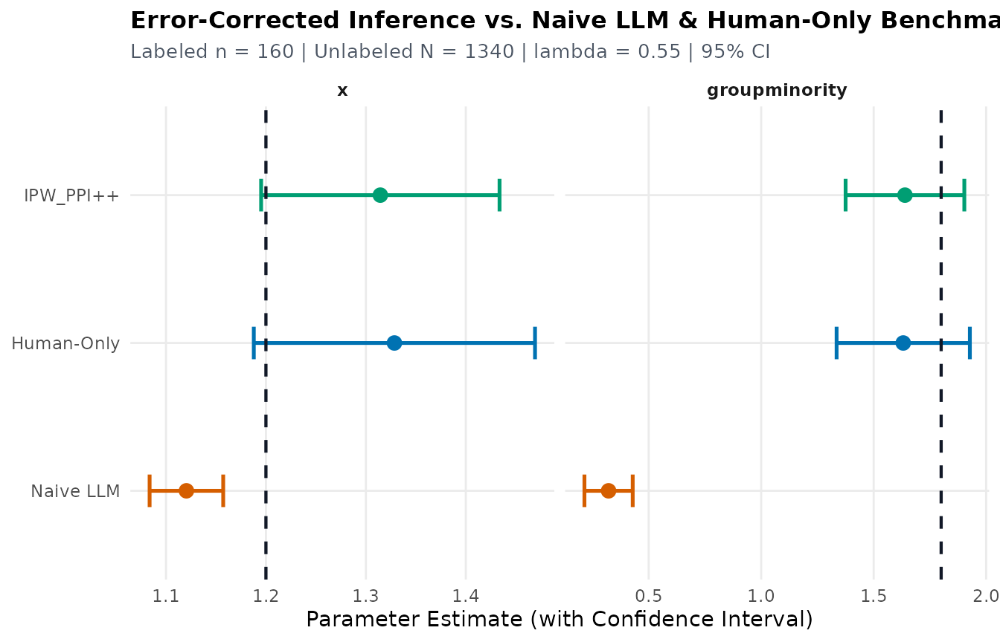
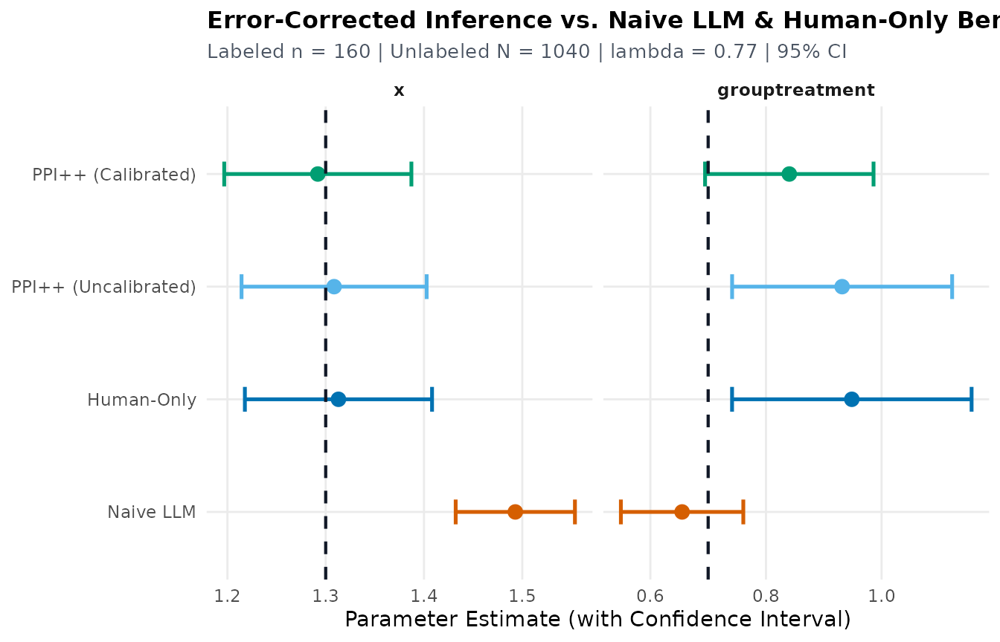

# Stratified Validation Sampling, IPW-PPI, Cross-Fitted Calibration, and Custom Backends

## Beyond Simple Random Validation and Linear Calibration

Standard Prediction-Powered Inference (`PPI` / `PPI++`) assumes that the
human-validated subset is drawn by simple random sampling (SRS) and uses
linear gradient rectifiers on the raw LLM predictions. In real applied
studies, researchers routinely encounter three additional challenges:

1.  **Unequal-probability validation sampling
    ([`select_validation_sample()`](https://marcusharrisphd.com/llmmetric/reference/select_validation_sample.md) +
    IPW-PPI):** When a minority subgroup represents only 15% of a
    corpus—or when extreme scores matter most—researchers oversample
    rare strata to maximize Differential Prompt Functioning (DPF) power
    or Neyman precision. Passing exact inclusion probabilities $`\pi_i`$
    or Horvitz-Thompson weights $`w_i = 1/\pi_i`$ to
    [`ppi_mean()`](https://marcusharrisphd.com/llmmetric/reference/ppi_mean.md)
    and
    [`ppi_lm()`](https://marcusharrisphd.com/llmmetric/reference/ppi_lm.md)
    activates exact Active / IPW-PPI++ estimation (Zrnic & Candès,
    2024).
2.  **Non-linear LLM score distortion
    ([`ppi_calibrated()`](https://marcusharrisphd.com/llmmetric/reference/ppi_calibrated.md)):**
    LLM ratings frequently suffer from floor/ceiling compression,
    S-curve saturation, or covariate-dependent non-linear distortion.
    [`ppi_calibrated()`](https://marcusharrisphd.com/llmmetric/reference/ppi_calibrated.md)
    learns a $`K`$-fold cross-fitted natural spline, polynomial,
    logistic, or custom calibrator strictly out-of-fold before applying
    `PPI++`, preserving exact unbiasedness while slashing standard
    errors.
3.  **Offline and custom scoring pipelines
    ([`backend_custom()`](https://marcusharrisphd.com/llmmetric/reference/backend_custom.md)):**
    Many research teams run local open-weights models, institutional
    endpoints, or offline packages (such as `airgapllm`) rather than
    hosted APIs.
    [`backend_custom()`](https://marcusharrisphd.com/llmmetric/reference/backend_custom.md)
    wraps any R callable into
    [`code_texts()`](https://marcusharrisphd.com/llmmetric/reference/code_texts.md)
    with zero added dependencies.

``` r

library(llmmetric)
```

------------------------------------------------------------------------

## 1. Stratified & Neyman Validation Sampling (`select_validation_sample()`)

Consider a corpus of $`M = 1{,}500`$ open-ended responses in which an
underrepresented subgroup (`group = "minority"`, 15% of the corpus) has
both a higher true distress mean and stronger predictor slope, while the
LLM exhibits systematic downward bias and slope attenuation:

``` r

set.seed(2026)
M <- 1500
group <- factor(
  c(rep("majority", 1275), rep("minority", 225)),
  levels = c("majority", "minority")
)
x <- rnorm(M)
is_min <- as.numeric(group == "minority")

# True outcome: mean differs sharply across groups and slope depends on x
y_true <- 2.0 + 1.2 * x + 1.8 * is_min + rnorm(M, sd = 0.9)

# Biased, attenuated LLM proxy with subgroup DPF
y_llm <- 0.9 + 0.65 * y_true - 0.8 * is_min + 0.35 * x + rnorm(M, sd = 0.5)

corpus <- tibble::tibble(
  unit_id = sprintf("u%04d", seq_len(M)),
  group = group,
  x = x,
  llm_score = y_llm,
  true_y = y_true
)
```

To ensure adequate statistical power for minority-group DPF auditing, we
draw $`n = 160`$ human validation texts using **equal allocation**
across the two subgroups (80 majority + 80 minority)—oversampling the
minority stratum by nearly $`6\times`$:

``` r

vs_equal <- select_validation_sample(
  corpus,
  n = 160,
  strategy = "stratified",
  strata_col = "group",
  allocation = "equal",
  seed = 101
)
vs_equal
#> 
#> ── Validation Sample Plan (stratified / equal)
#> Selected 160 of 1500 units (10.7%) | Weight range: [2.81, 15.94]
#> # A tibble: 2 × 6
#>   stratum  n_pop n_selected inclusion_prob weight stratum_sd
#>   <chr>    <int>      <int>          <dbl>  <dbl>      <dbl>
#> 1 majority  1275         80         0.0627  15.9          NA
#> 2 minority   225         80         0.356    2.81         NA
```

Notice that the Horvitz-Thompson weights $`w_i = 1 / \pi_i`$ sum exactly
to the corpus size $`M = 1{,}500`$:

``` r

sum(vs_equal$weights[vs_equal$selected])
#> [1] 1500
```

When minimizing overall variance is the primary goal (rather than
balanced subgroup DPF power), `strategy = "neyman"` allocates validation
budget proportionally to $`N_h \cdot \mathrm{SD}_h`$ using the observed
LLM scores:

``` r

vs_neyman <- select_validation_sample(
  corpus,
  n = 160,
  strategy = "neyman",
  strata_col = "group",
  score_col = "llm_score",
  seed = 101
)
vs_neyman$stratum_summary
#> # A tibble: 2 × 6
#>   stratum  n_pop n_selected inclusion_prob weight stratum_sd
#>   <chr>    <int>      <int>          <dbl>  <dbl>      <dbl>
#> 1 majority  1275        135          0.106   9.44       1.33
#> 2 minority   225         25          0.111   9          1.36
```

------------------------------------------------------------------------

## 2. Horvitz-Thompson Active / IPW-PPI (`ppi_mean()` & `ppi_lm()`)

Now suppose human annotators code only the $`n = 160`$ units selected by
`vs_equal`, leaving the remaining $`N = 1{,}340`$ units unlabeled
(`NA`). Because `minority` rows are heavily oversampled in the
validation set, an *unweighted* mean or regression over the labeled
sample severely overstates the population mean! Supplying
`inclusion_prob = "inclusion_prob"` (or `weights = "sampling_weight"`)
activates exact Horvitz-Thompson Active IPW-PPI++:

``` r

study_df <- vs_equal$data
study_df$human_score <- ifelse(study_df$is_validation, study_df$true_y, NA_real_)

# Population mean: compare true population mean vs unweighted vs IPW-PPI++
true_pop_mean <- mean(corpus$true_y)
fit_mean_unw <- ppi_mean(study_df, truth_col = "human_score", pred_col = "llm_score")
fit_mean_ipw <- ppi_mean(
  study_df,
  truth_col = "human_score",
  pred_col = "llm_score",
  inclusion_prob = "inclusion_prob"
)

tibble::tibble(
  estimator = c("True Population Mean", "Naive LLM", "Unweighted PPI++ (Biased)", "IPW-PPI++ (Valid)"),
  estimate = c(
    true_pop_mean,
    fit_mean_ipw$benchmarks$estimate[fit_mean_ipw$benchmarks$method == "naive_llm"],
    fit_mean_unw$estimates$estimate,
    fit_mean_ipw$estimates$estimate
  ),
  std_error = c(
    NA_real_,
    fit_mean_ipw$benchmarks$std_error[fit_mean_ipw$benchmarks$method == "naive_llm"],
    fit_mean_unw$estimates$std_error,
    fit_mean_ipw$estimates$std_error
  )
)
#> # A tibble: 4 × 3
#>   estimator                 estimate std_error
#>   <chr>                        <dbl>     <dbl>
#> 1 True Population Mean          2.25   NA     
#> 2 Naive LLM                     2.24    0.0345
#> 3 Unweighted PPI++ (Biased)     2.79    0.0807
#> 4 IPW-PPI++ (Valid)             2.34    0.0704
```

The same Horvitz-Thompson weighting applies seamlessly to linear
regression via
[`ppi_lm()`](https://marcusharrisphd.com/llmmetric/reference/ppi_lm.md):

``` r

fit_lm_ipw <- ppi_lm(
  human_score ~ x + group,
  data = study_df,
  pred_col = "llm_score",
  inclusion_prob = "inclusion_prob"
)
fit_lm_ipw
#> 
#> ── Prediction-Powered Inference (ipw_ppi++)
#> Labeled n = 160 | Unlabeled N = 1340 | lambda = 0.554 | CI = 95%
#> IPW weighted active inference | Kish effective labeled n = 107.4
#> # A tibble: 3 × 7
#>   term          estimate std_error conf_low conf_high p_value var_gain
#>   <chr>            <dbl>     <dbl>    <dbl>     <dbl> <chr>      <dbl>
#> 1 (Intercept)       2.11    0.0672     1.98      2.25 <0.0001     1.95
#> 2 x                 1.31    0.0609     1.20      1.43 <0.0001     1.39
#> 3 groupminority     1.64    0.135      1.38      1.90 <0.0001     1.26
format_apa_table(fit_lm_ipw)
#> **Comparison of Naive LLM, Human-Only, and IPW_PPI++ Parameter Estimates**
#> 
#> | Term | Estimator | Estimate | SE | 95% CI | p | Eff. Gain |
#> | --- | --- | --- | --- | --- | --- | --- |
#> | (Intercept) | Naive LLM | 2.195 | 0.020 | [2.155, 2.235] | &lt; .001 | -- |
#> | (Intercept) | Human-Only | 2.151 | 0.094 | [1.968, 2.335] | &lt; .001 | 1.00x |
#> | (Intercept) | IPW_PPI++ | 2.114 | 0.067 | [1.982, 2.246] | &lt; .001 | 1.95x |
#> | x | Naive LLM | 1.120 | 0.019 | [1.084, 1.157] | &lt; .001 | -- |
#> | x | Human-Only | 1.329 | 0.072 | [1.188, 1.469] | &lt; .001 | 1.00x |
#> | x | IPW_PPI++ | 1.314 | 0.061 | [1.195, 1.434] | &lt; .001 | 1.39x |
#> | groupminority | Naive LLM | 0.322 | 0.055 | [0.214, 0.429] | &lt; .001 | -- |
#> | groupminority | Human-Only | 1.631 | 0.151 | [1.335, 1.928] | &lt; .001 | 1.00x |
#> | groupminority | IPW_PPI++ | 1.639 | 0.135 | [1.375, 1.903] | &lt; .001 | 1.26x |
#> 
#> *Note.* Labeled validation n = 160; unlabeled LLM N = 1340; power-tuning lambda = 0.554. Eff. Gain denotes variance reduction (effective sample-size multiplier) relative to Human-Only.
```

``` r

autoplot(
  fit_lm_ipw,
  true_values = c("(Intercept)" = 2.0, x = 1.2, groupminority = 1.8)
)
```



IPW-PPI++ accurately recovers the population intercept, predictor slope,
and subgroup difference while shrinking confidence intervals
substantially relative to IPW Human-Only estimation—and avoiding the
dramatic bias of Naive LLM regression.

------------------------------------------------------------------------

## 3. Cross-Fitted Non-Linear Calibration (`ppi_calibrated()`)

Even under simple random validation sampling, raw LLM scores are often
non-linearly distorted (for example, compressed into a narrow S-curve
between 0 and 5 with covariate-dependent shift). Standard linear `PPI++`
remains unbiased, but its variance reduction is limited by the *linear*
correlation between $`Y`$ and $`\hat{Y}`$.

[`ppi_calibrated()`](https://marcusharrisphd.com/llmmetric/reference/ppi_calibrated.md)
learns a non-linear mapping $`\hat{m}(\hat{Y}, X) \approx Y`$ via strict
$`K`$-fold cross-fitting on the labeled subset
([`splines::ns()`](https://rdrr.io/r/splines/ns.html), polynomial,
logistic, or a user-supplied learner) so that every labeled prediction
is strictly out-of-fold and every unlabeled prediction uses the exact
fold-weighted average of the $`K`$ models:

``` r

set.seed(2027)
M_nl <- 1200
n_lab <- 160
x_nl <- rnorm(M_nl)
g_nl <- factor(sample(c("control", "treatment"), M_nl, replace = TRUE))
y_nl <- 1.0 + 1.3 * x_nl + 0.7 * (g_nl == "treatment") + rnorm(M_nl, sd = 0.75)

# Severe S-curve ceiling/floor compression + covariate shift
llm_nl <- 5 * stats::plogis(1.5 * (y_nl - 1.2) + 0.6 * x_nl) + rnorm(M_nl, sd = 0.18)

df_nl <- tibble::tibble(
  x = x_nl,
  group = g_nl,
  human_y = c(y_nl[seq_len(n_lab)], rep(NA_real_, M_nl - n_lab)),
  llm_y = llm_nl
)

fit_cal <- ppi_calibrated(
  human_y ~ x + group,
  data = df_nl,
  pred_col = "llm_y",
  calibrator = "spline",
  df = 4L,
  folds = 5L,
  seed = 2027
)
fit_cal
#> 
#> ── Prediction-Powered Inference (ppi++_calibrated)
#> Labeled n = 160 | Unlabeled N = 1040 | lambda = 0.772 | CI = 95%
#> Cross-fitted calibration (spline, 5-fold, df=4): r 0.938 -> 0.963 | RMSE 1.491
#> -> 0.423
#> # A tibble: 3 × 7
#>   term           estimate std_error conf_low conf_high p_value var_gain
#>   <chr>             <dbl>     <dbl>    <dbl>     <dbl> <chr>      <dbl>
#> 1 (Intercept)       0.941    0.0558    0.831     1.05  <0.0001     1.86
#> 2 x                 1.29     0.0486    1.20      1.39  <0.0001     1   
#> 3 grouptreatment    0.840    0.0743    0.695     0.986 <0.0001     2.02
```

Notice how out-of-fold spline calibration dramatically boosts human-LLM
correlation (`r_raw` to `r_calibrated_oof`) and cuts prediction RMSE,
translating directly into tighter, provably valid confidence intervals
compared to both Human-Only and uncalibrated `PPI++`:

``` r

format_apa_table(fit_cal, include_intercept = FALSE)
#> **Comparison of Naive LLM, Human-Only, and PPI++_CALIBRATED Parameter Estimates**
#> 
#> | Term | Estimator | Estimate | SE | 95% CI | p | Eff. Gain |
#> | --- | --- | --- | --- | --- | --- | --- |
#> | x | Naive LLM | 1.493 | 0.031 | [1.432, 1.554] | &lt; .001 | -- |
#> | x | Human-Only | 1.313 | 0.049 | [1.218, 1.408] | &lt; .001 | 1.00x |
#> | x | PPI++ (Uncal.) | 1.309 | 0.048 | [1.214, 1.403] | &lt; .001 | -- |
#> | x | PPI++ (Calibrated) | 1.292 | 0.049 | [1.197, 1.387] | &lt; .001 | 1.00x |
#> | grouptreatment | Naive LLM | 0.655 | 0.054 | [0.549, 0.761] | &lt; .001 | -- |
#> | grouptreatment | Human-Only | 0.949 | 0.106 | [0.741, 1.156] | &lt; .001 | 1.00x |
#> | grouptreatment | PPI++ (Uncal.) | 0.932 | 0.097 | [0.741, 1.122] | &lt; .001 | -- |
#> | grouptreatment | PPI++ (Calibrated) | 0.840 | 0.074 | [0.695, 0.986] | &lt; .001 | 2.02x |
#> 
#> *Note.* Labeled validation n = 160; unlabeled LLM N = 1040; power-tuning lambda = 0.772. Eff. Gain denotes variance reduction (effective sample-size multiplier) relative to Human-Only.
autoplot(fit_cal, true_values = c(x = 1.3, grouptreatment = 0.7))
```



Researchers can also supply a completely custom calibration learner via
`calibrator = function(train_df, new_df, truth_col, pred_col, rhs_vars) { ... }`
(for instance, wrapping a random forest, GAM, or gradient-boosted tree
from another package).

------------------------------------------------------------------------

## 4. Integrating Local & Offline Models via `backend_custom()`

When your workflow uses a local open-weights LLM, an institutional
Python/C++ runner, or an air-gapped R package (such as `airgapllm`),
[`backend_custom()`](https://marcusharrisphd.com/llmmetric/reference/backend_custom.md)
adapts any R function `fn(request)` directly into
[`code_texts()`](https://marcusharrisphd.com/llmmetric/reference/code_texts.md)—giving
you full JSON schema validation, retry handling, content-addressed disk
caching, resumable checkpointing, and direct entry into
[`g_study()`](https://marcusharrisphd.com/llmmetric/reference/g_study.md),
[`dpf_test()`](https://marcusharrisphd.com/llmmetric/reference/dpf_test.md),
and
[`ppi_lm()`](https://marcusharrisphd.com/llmmetric/reference/ppi_lm.md)
with zero added dependencies:

``` r

# Wrap any local scorer into an llmmetric backend
local_scorer <- backend_custom(
  fn = function(req) {
    # Inspect req$text, req$prompt_id, req$model, req$temperature, req$schema
    base_val <- 2.5 + 0.08 * nchar(req$text)
    prompt_shift <- if (identical(req$prompt_id, "rubric_v2")) 0.35 else 0.0
    list(score = min(max(round(base_val + prompt_shift, 2), 1), 7))
  },
  name = "local_airgap_scorer",
  version = "1.0"
)
local_scorer
#> 
#> ── LLM Backend (custom)
#> ID: custom_63e41e92ca63
#> Name: local_airgap_scorer | Version: 1.0

sample_texts <- tibble::tibble(
  unit_id = paste0("doc_", 1:6),
  text = c(
    "Calm morning walk.",
    "Feeling tense before the clinic review.",
    "Overwhelmed by back-to-back deadlines and poor sleep.",
    "Peaceful afternoon reading outside.",
    "Anxious about upcoming travel and family obligations.",
    "Steady focus throughout the workday."
  )
)

design <- coding_design(
  prompts = c(
    rubric_v1 = "Rate distress 1-7: {text}",
    rubric_v2 = "Score emotional strain 1-7: {text}"
  ),
  models = "local-8b"
)

coded <- code_texts(
  data = sample_texts,
  text_col = "text",
  id_col = "unit_id",
  design = design,
  backend = local_scorer,
  cache = coding_cache("memory")
)
coded$data[, c("unit_id", "prompt", "model", "score", "cache_hit")]
#> NULL
```

The resulting `llm_coded_data` object flows directly into
[`g_study()`](https://marcusharrisphd.com/llmmetric/reference/g_study.md),
[`d_study()`](https://marcusharrisphd.com/llmmetric/reference/d_study.md),
[`calibration_metrics()`](https://marcusharrisphd.com/llmmetric/reference/calibration_metrics.md),
[`dpf_test()`](https://marcusharrisphd.com/llmmetric/reference/dpf_test.md),
and
[`ppi_lm()`](https://marcusharrisphd.com/llmmetric/reference/ppi_lm.md).

------------------------------------------------------------------------

## References

- Angelopoulos, A. N., Bates, S., Fannjiang, C., Jordan, M. I., &
  Zrnic, T. (2023). Prediction-powered inference. *Science*, 382(6671),
  669–674.
- Angelopoulos, A. N., Duchi, J. C., & Zrnic, T. (2024). PPI++:
  Efficient prediction-powered inference. *arXiv:2311.01453*.
- Zrnic, T., & Candès, E. J. (2024). Active statistical inference.
  *Proceedings of the 41st International Conference on Machine Learning
  (ICML)*.
